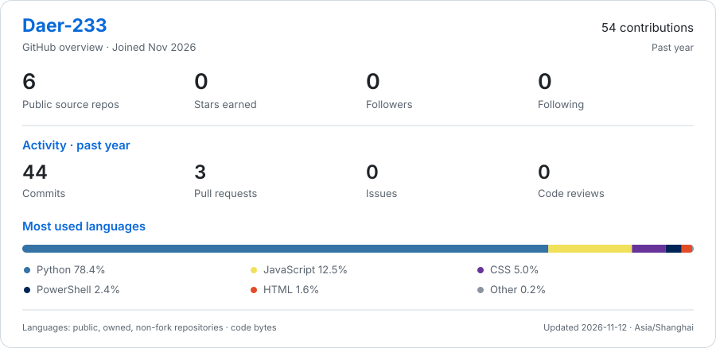

# Hi there, I'm Daer-233 👋

AI 应用工程 · 企业知识助手、RAG 与设计工作流自动化

Building evidence-backed knowledge assistants and automation tools for design workflows.

  
  
  

<picture>
  <source media="(prefers-color-scheme: dark)" srcset="./assets/github-snake-dark.svg" />
  <source media="(prefers-color-scheme: light)" srcset="./assets/github-snake.svg" />
  
</picture>

绿色：真实贡献，位置固定，每轮只吃一部分 · 蓝 / 橙 / 粉：装饰方块，每轮换位，不计进度

## GitHub 数据

<picture>
  <source media="(prefers-color-scheme: dark)" srcset="./assets/github-stats-dark.svg" />
  <source media="(prefers-color-scheme: light)" srcset="./assets/github-stats.svg" />
  
</picture>

## 精选项目

| 项目 | 做了什么 | 从哪里看 |
| --- | --- | --- |
| [WorkRAG](https://github.com/Daer-233/WorkRAG) | 钉钉图文知识助手。支持混合检索、来源引用、配图和同资料追问。 | [系统架构](https://github.com/Daer-233/WorkRAG#系统架构) · [脱敏评测](https://github.com/Daer-233/WorkRAG/blob/main/docs/evaluation.md) |
| [Design RAG](https://github.com/Daer-233/design-rag) | 面向设计资料的知识库。覆盖文档入库、父子分块、混合召回、重排和来源定位。 | [检索评测](https://github.com/Daer-233/design-rag/blob/main/docs/rag-stage1-evaluation-20261028.md) · [开源依赖](https://github.com/Daer-233/design-rag/blob/main/OPEN_SOURCE.md) |

## 项目演进

- **先打通设计资料检索。** 将文档分块、访问范围和来源信息保存到 PostgreSQL，用 Qdrant 提供可重建的检索索引。[阶段实现](https://github.com/Daer-233/design-rag-worktree-688d#readme)
- **再接入网页问答。** 用 LangGraph 编排问答，复用检索服务和证据定位。[实现记录](https://github.com/Daer-233/design-rag/commit/a49cf992a0dbecda9e359794592c2b684f82ec13)
- **将图文检索用于钉钉场景。** WorkRAG 本机试点用 20 道预标注题测量检索表现。15 道有依据题的 Hit@5 为 15/15，5 道无依据题中有 3 道正确返回证据不足。[用例与测量口径](https://github.com/Daer-233/WorkRAG/blob/main/docs/evaluation.md)
